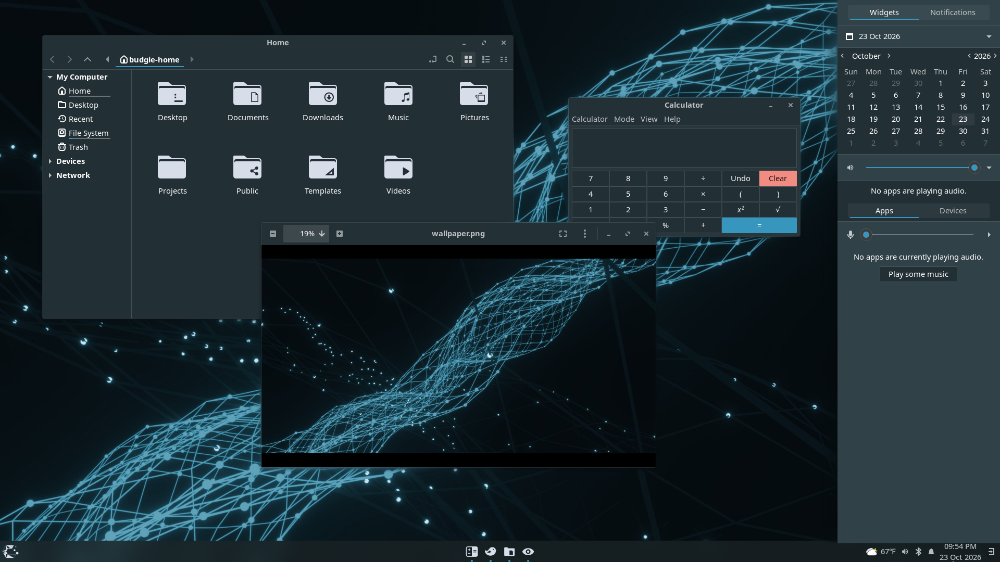
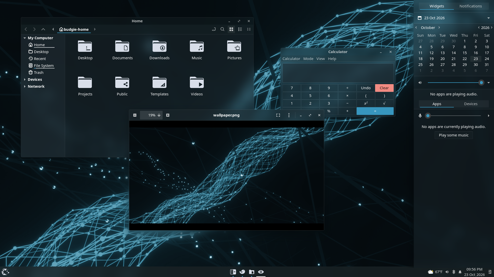

# Nexus gtk theme

Nexus is a GTK theme for GNOME/GTK based desktop environments with a deep-navy and
cyan palette, built for translucent, blurred desktops.

It is a fork of [Fluent gtk theme](https://github.com/vinceliuice/Fluent-gtk-theme)
by vinceliuice. All of the theme's structure, widgets and assets come from Fluent;
Nexus changes its colors.

### Normal version


### Blur version


<sub>Screenshots: Budgie on Wayfire with the Wayfire blur plugin. Icons are
[Yet Another Monochrome Icon Set](https://bitbucket.org/dirn-typo/yet-another-monochrome-icon-set/src/main/);
the wallpaper is a recolored photo by Conny Schneider (see
[Credits](#credits-and-license)).</sub>

## Changes from Fluent

Modified on 2026-10-23:

- **New palette.** The accent and neutral colors are sampled from a dark
  network/plexus wallpaper:

  | | Light | Dark |
  |---|---|---|
  | Accent | `#1B7299` | `#3796BE` |
  | Neutrals | Fluent's greys tinted to hue 197° (18% saturation), same lightness | Fluent's greys tinted to hue 197° (20% saturation), same lightness |

- **More translucent blur version.** `--tweaks blur` uses half of Fluent's
  background opacity: 0.25 for dark, 0.425 for light.
- **One color scheme.** Fluent's color variants (blue, purple, pink, red, orange,
  yellow, green, teal and grey) and the `-t/--theme` option are removed.
- **Renamed** from Fluent to Nexus.

The wallpaper the palette was taken from is not included, because its license is
unknown. The theme only uses colors sampled from it; the screenshots use a
different, freely licensed wallpaper (see [Credits](#credits-and-license)).

## Requirements

- GTK `>=3.20`
- `gnome-themes-extra` (or `gnome-themes-standard`)
- Murrine engine — The package name depends on the distro.
  - `gtk-engine-murrine` on Arch Linux
  - `gtk-murrine-engine` on Fedora
  - `gtk2-engine-murrine` on openSUSE
  - `gtk2-engines-murrine` on Debian, Ubuntu, etc.
- `sassc` — build dependency

### Blur

The blur version only makes the theme translucent. The blur itself comes from
your compositor, for example:

- GNOME Shell: [Blur My Shell](https://github.com/aunetx/blur-my-shell)
- Wayfire (including Budgie on Wayland): the `blur` plugin

## Installation

### Manual Installation

Run the following commands in the terminal:

```sh
./install.sh
```

For example, the dark, compact, blur version with a link for libadwaita apps:

```sh
./install.sh -c dark -s compact --tweaks blur -l
```

> Tip: `./install.sh` allows the following options:

```
-d, --dest DIR          Specify destination directory (Default: $HOME/.local/share/themes)

-n, --name NAME         Specify theme name (Default: Nexus)

-c, --color VARIANT     Specify color variant(s) [standard|light|dark] (Default: All variants)

-s, --size VARIANT      Specify size variant [standard|compact] (Default: All variants)

-i, --icon VARIANT      Specify icon variant(s) for shell panel
                        [default|apple|simple|gnome|ubuntu|arch|manjaro|fedora|debian|void|opensuse|popos|mxlinux|zorin|endeavouros|tux|nixos]
                        (Default: Windows)

-l, --libadwaita        Install link to gtk4 config for theming libadwaita

-r, --remove
-u, --uninstall         Uninstall/remove themes or link for libadwaita

--tweaks                Specify versions for tweaks [solid|float|round|blur|noborder|square]
                        solid:    no transparency version
                        float:    floating panel
                        round:    rounded windows
                        blur:     blur version for 'Blur-Me'
                        noborder: windows and menu with no border
                        square:   square windows button

-h, --help              Show help
```

> For more information, run: `./install.sh --help`

### Flatpak Installation

Automatically install your host GTK+ theme as a Flatpak.

- [pakitheme](https://github.com/refi64/pakitheme)

### Firefox theme
[Install Firefox theme](src/firefox)

### Fix for Dash to panel

Just install the compact version

```sh
./install.sh -s compact
```

## Credits and license

- [Fluent gtk theme](https://github.com/vinceliuice/Fluent-gtk-theme) by
  vinceliuice, which Nexus is based on. Its
  [Fluent Icon theme](https://github.com/vinceliuice/Fluent-icon-theme) pairs well
  with Nexus and is what `index.theme` points to.
- Icons in the screenshots:
  [Yet Another Monochrome Icon Set](https://bitbucket.org/dirn-typo/yet-another-monochrome-icon-set/src/main/)
  by Dirn (GPL-3.0).
- Wallpaper in the screenshots:
  [photo by Conny Schneider (@choys_)](https://unsplash.com/photos/a-blue-abstract-background-with-lines-and-dots-pREq0ns_p_E)
  on Unsplash, used under the [Unsplash License](https://unsplash.com/license) and
  recolored to the Nexus palette. The wallpaper itself is not part of Nexus.

Nexus is licensed under the GNU General Public License v3.0, the same as Fluent.
See [COPYING](COPYING).
